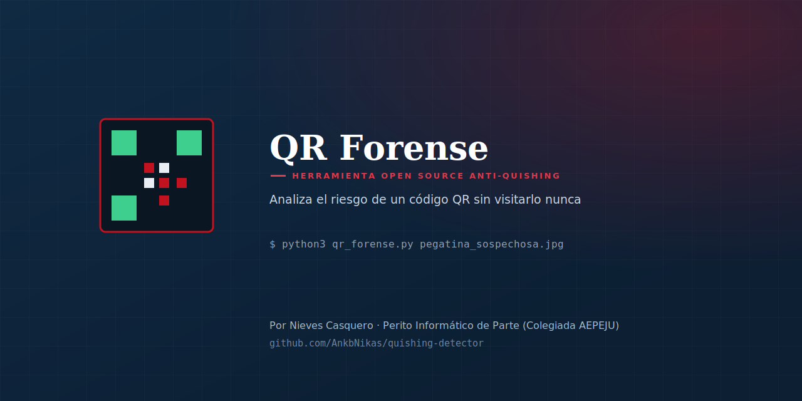
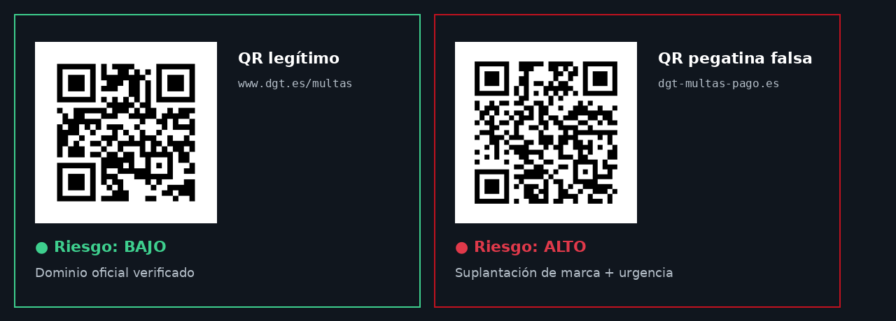

<p align="center">
  
</p>

<p align="center">
  
  
  
</p>

# QR Forense

Herramienta de línea de comandos que analiza el **riesgo de phishing (quishing)** de un código QR a partir de una foto o imagen — **sin visitar nunca la URL**. Decodifica el contenido y aplica un conjunto de heurísticas estructurales (suplantación de marca, trucos de URL, TLDs sospechosos, acortadores...) para dar una puntuación de riesgo explicable.

## ¿Por qué existe esta herramienta?

España concentra el **17% de las estafas de código QR a nivel mundial** — solo por detrás de EE.UU. — y las denuncias por esta modalidad se dispararon un 300% en 2025 (ESET Threat Report H1 2026, Policía Nacional). El mecanismo es siempre el mismo: una pegatina falsa sobre el QR legítimo de un parquímetro, una carta de restaurante o un aviso de paquetería, que lleva a una web que suplanta a una entidad real.

Existen algunas herramientas similares en GitHub, pero casi todas dependen de una API de pago (OpenAI, VirusTotal) para funcionar. Esta analiza el código **completamente offline por defecto**, con reglas transparentes y explicables — sabes exactamente por qué se marca algo como sospechoso.

## Ejemplo real

<p align="center">
  
</p>

```
$ python3 qr_forense.py pegatina_parquimetro.jpg

[*] Contenido detectado: https://dgt-multas-pago.es/tasa?id=88213
    -> Riesgo: ALTO

Hallazgos:
- El dominio menciona 'dgt' pero no coincide con ningún dominio oficial
  conocido (dgt.es, sede.dgt.gob.es). Posible suplantación de marca.
- Contiene términos asociados a presión/urgencia: tasa, pago, multa.
```

## Instalación

```bash
git clone https://github.com/AnkbNikas/quishing-detector.git
cd quishing-detector
pip install opencv-python
pip install python-whois   # opcional, para comprobar antigüedad del dominio
```

## Uso

```bash
python3 qr_forense.py foto_qr.jpg

# Con comprobación de antigüedad del dominio (requiere internet)
python3 qr_forense.py foto_qr.jpg --whois
```

## Qué comprueba

- 🔗 Truco del símbolo `@` en la URL
- 🔑 Credenciales (`usuario:contraseña@`) en texto plano en la propia URL — independiente del truco del `@` y se suma a él
- ↩️ `\` antes del host en vez de `/` (p. ej. `evil.top\@dgt.es`), el mismo truco que el del `@` pero a través de cómo lo corrigen los navegadores
- 🌐 IP en lugar de dominio, incluida una IP disfrazada en decimal, hexadecimal, octal o como literal IPv6
- 🔤 Punycode / posibles ataques homógrafo, incluyendo homógrafos en Unicode (cirílico, ancho completo...) una vez convertidos a su forma Punycode
- ✂️ Acortadores de enlaces
- 🏳️ TLDs de bajo coste habitualmente usados en phishing (.tk, .top, .xyz...)
- 🏦 Suplantación de marcas habituales (DGT, Correos, bancos, mensajería...) — lista ampliable en el propio script
- 🕓 Antigüedad del dominio vía WHOIS (opcional, requiere internet)
- ⚠️ Términos de presión/urgencia en la URL (en español y, de momento, en checo, danés, alemán, estonio, finés, francés, croata, húngaro, italiano, lituano, neerlandés, noruego, polaco, portugués, rumano, eslovaco y esloveno), incluso si están ocultos tras un escape porcentual en la ruta o escritos sin sus diacríticos
- 💣 Esquemas peligrosos (`javascript:`, `data:`, `vbscript:`, `file:`, `blob:`, `intent:`) que ejecutan código o cargan contenido arbitrario — riesgo ALTO directo
- 🔓 `http://` sin cifrar, cuando el contenido original ya traía ese esquema (no se puntúa si lo añade el propio script, ni si el destino ya es una IP)

## Normalización de la URL antes de analizarla

Antes de aplicar las comprobaciones anteriores, la URL se normaliza igual
que lo haría un navegador, para que un disfraz en la propia URL no engañe
al análisis:

- se recortan los espacios en blanco del contenido decodificado del QR;
- una URL que `urlsplit()` no puede interpretar (o sin host) se trata como
  "URL malformada", en vez de interrumpir el programa con un traceback;
- un `\` antes del host se trata como `/`, tal y como hacen los
  navegadores, y además genera el hallazgo anterior;
- el host se decodifica si contiene secuencias de escape porcentual
  (`%70aypal.evil.com` → `paypal.evil.com`);
- un único punto final en el host (`bit.ly.`) se analiza como si no
  estuviera;
- un host en Unicode se convierte a su forma Punycode con el códec `idna`
  de la librería estándar (IDNA 2003). Los navegadores actuales usan UTS
  #46 no transicional, que difiere de IDNA 2003 en casos como `straße.de`
  (IDNA 2003 la convierte a `strasse.de`; UTS #46 no transicional la deja
  en `straße.de` codificada en Punycode). No se ha añadido una dependencia
  nueva para evitar esa diferencia.

## Tests

Pruebas unitarias con `unittest` (librería estándar, sin dependencias nuevas). Fijan la puntuación y los hallazgos de los cinco casos de `ejemplos/` y los umbrales de `clasificar_riesgo`:

```bash
python3 -m unittest discover -s tests
```

No hace falta tener OpenCV instalado para ejecutarlas — `decodificar_qr` solo importa `cv2` al decodificar una imagen real.

## ⚖️ Límites — lectura obligatoria

- Es un análisis **heurístico y estructural**, no consulta listas negras de phishing en tiempo real ni analiza el contenido real de la web de destino.
- Puntuación baja **no** garantiza que el enlace sea seguro. Puntuación alta **no** es prueba definitiva de phishing — son señales de alerta, no un veredicto.
- La lista de marcas suplantadas es orientativa y ampliable; no cubre todas las posibles víctimas de suplantación.

## Licencia

MIT — ver [LICENSE](./LICENSE).

## Autora

**Nieves Casquero** — Perito Informático de Parte (Colegiada AEPEJU), Especialista en Ciberseguridad y Pentester

- GitHub: [@AnkbNikas](https://github.com/AnkbNikas)
- Web: [nievescasquero.github.io](https://nievescasquero.github.io)
- LinkedIn: [nieves-kaskero](https://www.linkedin.com/in/nieves-kaskero/)

Si te resulta útil, una ⭐ en el repositorio ayuda a que llegue a más gente antes de que caiga en una pegatina falsa.
